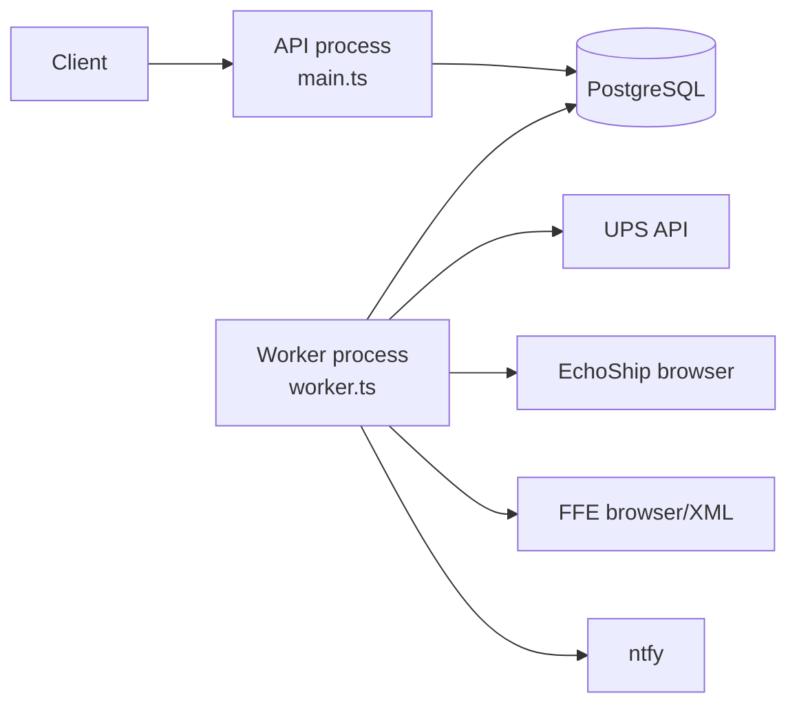

# V1 architecture

## Runtime topology



The API and worker are two composition roots from one modular-monolith codebase. They share entity/repository contracts and PostgreSQL, but they do not call each other in memory. V1 runs exactly one worker, so process-local Carrier rate limiters and a simple PostgreSQL queued-run handoff are acceptable.

The worker starts polling automatically after configuration and database readiness checks pass. Operational stop/restart uses the process/container lifecycle. `carriers.is_active` controls whether a Carrier receives new scheduled work.

## Composition roots

```text
AppModule
├── LoggingModule
├── ApplicationCacheModule
├── DatabaseModule
├── HealthModule
├── AuthModule             # after the auth decision ticket
├── CarriersModule
├── ShipmentsModule
├── TrackingHttpModule
└── EventsModule

WorkerModule
├── LoggingModule
├── ApplicationCacheModule
├── DatabaseModule
├── CarrierAdaptersModule
├── TrackingWorkerModule
└── NotificationsModule
```

The scheduler is registered only in the worker composition root. Starting an API replica must never start polling.

## Module seams

- Controllers translate HTTP and never construct TypeORM queries.
- Application services own use-case orchestration and transaction intent.
- Services depend on repository contracts defined inside the owning feature.
- Carrier-specific V1-007 override: `CarriersService` injects the concrete
  `TypeOrmCarriersRepository` directly. The user removed its separate contract
  file and Symbol token; queries remain encapsulated in the feature repository.
- TypeORM repository implementations own persistence queries.
- Carrier adapters implement one small tracking interface and hide authentication, HTTP/browser behavior, mapping, retries, and provider-specific validation.
- Feature cache services hide cache keys and invalidation behind `AbstractCacheService<TValue>`.
- Application code logs through the project-owned structured logger; only logging infrastructure imports Pino.

## Scheduled flow

```text
Worker wakes every 60 seconds
  -> select active Shipments with next_check_at <= now()
  -> group due Shipments by Carrier
  -> create one tracking_run per Carrier execution
  -> open the Carrier adapter session
  -> create/finalize one tracking_attempt per Shipment
  -> insert a snapshot only when normalized known data changed
  -> update Shipment outcome counters and next_check_at
  -> finish the run and publish allowed notifications/events
```

The scheduler tick is only a due-work scan. A Shipment's effective interval is `max(carriers.poll_interval_minutes, adapter hard minimum)`.

## Manual refresh flow

```text
Authenticated API request
  -> create queued manual tracking_run for one Shipment
  -> return 202 with the run external_id
  -> worker checks queued manual work before the next scheduled batch
  -> execute with the same adapter/outcome transaction rules
  -> API exposes run status and events
```

Manual refresh bypasses `next_check_at` and the scheduled minimum interval, but it still obeys the Carrier request-per-minute limiter. It does not move an already-active Shipment's existing scheduled `next_check_at`. A successful refresh may reactivate a Shipment paused by the not-found threshold.

## Concurrency and recovery

V1 has one worker and permits only one active run per Carrier. The worker must prevent overlapping scheduler ticks. A worker restart clears in-memory cache and sessions. On startup, stale `running` runs from the interrupted process are finalized as failed/interrupted; v1 does not claim exactly-once processing.

Three or more workers are a later architecture milestone. That milestone requires atomic claims, leases/heartbeats, idempotency, shared or partitioned Carrier quotas, and durable recovery. Do not partially implement those mechanisms in v1.

## Cache

Both composition roots import the same global cache module, but each process receives an independent in-memory store. PostgreSQL remains authoritative. Cache misses and cache loss must change performance only, never correctness. See [`cache-design.md`](cache-design.md).

## Structured logging

The API and worker use the same Pino-backed logging module. Production writes newline-delimited JSON to stdout/stderr for the runtime to collect; the application does not write or rotate log files. Local pretty printing is an optional development command only.

Every record has a stable event name, message, level, service, component, and safe structured fields. HTTP logs carry a request correlation ID. Worker logs use child loggers carrying the run external ID, Carrier code, and safe execution context. Tracking references, credentials, authorization headers, cookies, raw Carrier responses, browser artifacts, and `source_data` are never logged.

Unknown errors pass through a safe projection before logging. It may retain an allowlisted error name/code, HTTP status, and application-local source location, but it must not serialize the original `Error`, stack, cause, request configuration, provider response, or headers. The implementation follows Ticket V1-017 and the approved reference module.

## Authentication boundary

Audit actor IDs are nullable until auth is implemented. Clients never submit actor IDs; authenticated application services populate them. Worker/system writes use null until a system-actor model is explicitly approved. See [`auth-plan.md`](auth-plan.md).
