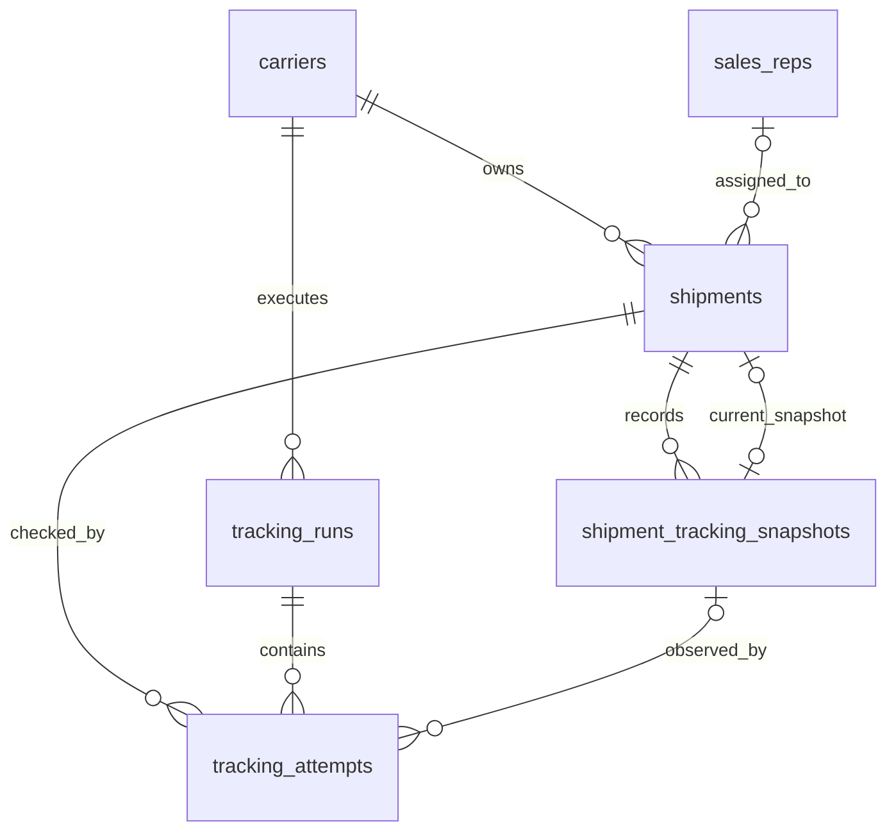

# Backend PostgreSQL schema

## Status

Finalized initial schema for the fresh NestJS backend. Implement it with reviewed TypeORM migrations; do not use TypeORM schema synchronization outside disposable local experiments.

The initial schema has six tables:

1. `carriers`
2. `shipments`
3. `sales_reps`
4. `shipment_tracking_snapshots`
5. `tracking_runs`
6. `tracking_attempts`

Raw-artifact storage, source-data retention, notifications/outbox, and a durable queue remain outside this initial schema.

## Relationship diagram



## Foreign-key deletion policy

Every initial foreign key explicitly uses `ON DELETE NO ACTION`, with immediate,
non-deferrable checks. This user-approved V1-005 decision supersedes the earlier
cascade/restrict policies. Future foreign keys follow the default in `AGENTS.md`;
another deletion action requires an explicit user override.

Soft deletion preserves relationships. A permanent Shipment purge must explicitly
clear its current-snapshot pointer, delete its attempts, delete its snapshots,
and finally delete the Shipment in one transaction. A tracking run can be deleted
only after its attempts are removed; a Carrier only after its Shipments and runs
are removed. This ticket verifies those database rules but adds no purge API.

## Shared entity columns

Mutable API-exposed business entities—initially Carrier, Sales Rep and Shipment—extend `ExternallyIdentifiedEntity`, which extends `AuditableEntity`.

| Column          | Type                                   | Null | Rule                                                            |
| --------------- | -------------------------------------- | ---- | --------------------------------------------------------------- |
| `id`            | `integer generated always as identity` | No   | Internal primary key; never expose through the API.             |
| `external_id`   | `uuid`                                 | No   | Immutable, unique, database-generated with `gen_random_uuid()`. |
| `created_at`    | `timestamptz`                          | No   | Defaults to `now()`.                                            |
| `updated_at`    | `timestamptz`                          | No   | Defaults to `now()` and is maintained by TypeORM writes.        |
| `deleted_at`    | `timestamptz`                          | Yes  | Soft-deletion timestamp.                                        |
| `created_by_id` | `integer`                              | Yes  | Future User relation; no foreign key initially.                 |
| `updated_by_id` | `integer`                              | Yes  | Future User relation; no foreign key initially.                 |
| `deleted_by_id` | `integer`                              | Yes  | Future User relation; no foreign key initially.                 |

Append-only history and operational tables use purpose-specific timestamps instead of inheriting misleading soft-delete and actor-update fields.

Both primary `id` and public `external_id` values are immutable after insertion.
Reviewed migrations must reject changes at the PostgreSQL boundary, including
direct SQL and resetting an identity with `SET id = DEFAULT`. TypeORM mapping
restrictions alone are insufficient. V1-004 proves this with a disposable fixture;
V1-005 applies it to the production tables.

## Database enums

| Enum                         | Values                                                                         |
| ---------------------------- | ------------------------------------------------------------------------------ |
| `shipment_monitoring_status` | `active`, `paused`, `completed`                                                |
| `shipment_monitoring_reason` | `manual`, `not_found_threshold`, `delivered`                                   |
| `tracking_run_trigger`       | `scheduled`, `manual`                                                          |
| `tracking_run_status`        | `queued`, `running`, `succeeded`, `partially_succeeded`, `failed`, `cancelled` |
| `tracking_attempt_outcome`   | `pending`, `found`, `not_found`, `failed`, `skipped`                           |

## 1. `carriers`

One row identifies a Carrier and selects its adapter.

| Column                      | Type           | Null | Default/meaning                                                                  |
| --------------------------- | -------------- | ---- | -------------------------------------------------------------------------------- |
| shared entity columns       | —              | —    | Full externally identified audit base.                                           |
| `code`                      | `varchar(50)`  | No   | Stable adapter key.                                                              |
| `name`                      | `varchar(100)` | No   | Carrier display name.                                                            |
| `is_active`                 | `boolean`      | No   | `true`; controls whether new tracking work may use the Carrier.                  |
| `not_found_pause_threshold` | `smallint`     | No   | `5`; consecutive `not_found` results required to pause.                          |
| `poll_interval_minutes`     | `smallint`     | No   | Desired minutes between scheduled checks for a Shipment.                         |
| `rate_limit_per_minute`     | `smallint`     | Yes  | Maximum physical Carrier requests per minute; null disables the generic limiter. |

Rules:

- By the approved V1-007 scope, only reviewed migrations accompanying an implemented
  adapter may create Carriers. Use explicit, nonempty stable adapter codes up to
  50 characters. Automatic slug generation and application creation are deferred.
- Keep `code` immutable when `name` changes.
- Enforce unique `external_id` and unique `code`, including across soft-deleted rows.
- Enforce `not_found_pause_threshold >= 2`; the initial value for every Carrier is `5`.
- Enforce `poll_interval_minutes >= 1`; seed UPS with `30`, EchoShip with `5`, and FFE with `5`.
- Enforce `rate_limit_per_minute IS NULL OR rate_limit_per_minute >= 1`; seed UPS with `10` and leave EchoShip and FFE null initially.
- The effective request limit is the stricter of the database value and the adapter/provider hard maximum. UPS CIE remains capped at 5 requests per minute even when the database value is 10.
- Every physical Carrier request, including a retry inside one logical Attempt, consumes the applicable rate limit.
- The initial single-node worker may enforce this limit in process. If tracking workers later run on multiple nodes, they must share or partition the Carrier quota so each node does not independently spend the full limit.
- Carrier credentials and endpoints remain configuration/secrets, not database columns.
- Referenced Carriers use `ON DELETE NO ACTION`; normal removal is soft deletion or `is_active = false`.

V1-014 adds `carriers.fetch_mode varchar(10) NOT NULL DEFAULT 'request'`, checked
against `request`/`browser`. Existing UPS and EchoShip use request. V1-014 initially
set FFE to browser; V1-015's `FfeRequestMode1792022400000` migration changes it to
request (down restores browser), without editing historical runs. The Carrier API
exposes `fetchMode` and rejects unsupported choices
(UPS request only, EchoShip and FFE either). This is the sole mode source;
credentials/endpoints remain environment configuration.

The same migration adds nullable `tracking_runs.fetch_mode varchar(10)` with the
same value check. Queued and historical runs stay null. Starting a run captures
the selected Carrier mode under a shared Carrier lock in the start transaction;
later Carrier edits cannot change that run's mode. No new foreign key or event
timestamp column is introduced. Rollback drops these two configuration/evidence
columns and their checks; it therefore discards recorded mode history.

- V1-007 exposes reads and configuration updates only. Administrators use
  `is_active` to disable/enable; no Carrier deletion or restoration API is exposed.
  Existing soft-deleted Carriers are excluded from reads, updates, and active selection.

### Deferred Carrier configuration candidates

These are useful future columns, but they are not part of the initial migration. Add each only when its behavior is implemented and tested.

| Column                  | Proposed type           | Purpose                                                                 |
| ----------------------- | ----------------------- | ----------------------------------------------------------------------- |
| `max_concurrency`       | `smallint` nullable     | Limit simultaneous lookups for one Carrier.                             |
| `failure_retry_minutes` | `smallint` nullable     | Override the delay before retrying a technical Carrier failure.         |
| `display_order`         | `smallint` nullable     | Control Carrier ordering in administrative and selection interfaces.    |
| `maintenance_message`   | `varchar(500)` nullable | Explain why a Carrier is unavailable when an administrator disables it. |

Keep protocol-specific request and browser-navigation timeouts in adapter configuration because those operations have different semantics. Do not add an unstructured Carrier `config jsonb` column as a substitute for reviewed, constrained columns.

## 2. `shipments`

One row represents a Carrier-owned reference that the application monitors.

| Column                         | Type                         | Null | Default/meaning                                                                        |
| ------------------------------ | ---------------------------- | ---- | -------------------------------------------------------------------------------------- |
| shared entity columns          | —                            | —    | Full externally identified audit base.                                                 |
| `carrier_id`                   | `integer`                    | No   | FK to `carriers.id`; `ON DELETE NO ACTION`.                                            |
| `tracking_reference`           | `varchar(255)`               | No   | Tracking number, Shipment ID, or order number understood by the Carrier.               |
| `notes`                        | `varchar(500)`               | Yes  | User-maintained note.                                                                  |
| `verification_url`             | `text`                       | Yes  | Carrier tracking URL.                                                                  |
| `monitoring_status`            | `shipment_monitoring_status` | No   | `active`.                                                                              |
| `monitoring_reason`            | `shipment_monitoring_reason` | Yes  | Why monitoring is paused or completed.                                                 |
| `current_tracking_snapshot_id` | `bigint`                     | Yes  | Current normalized snapshot.                                                           |
| `last_attempted_at`            | `timestamptz`                | Yes  | Completion time of the latest finalized logical Carrier lookup, regardless of outcome. |
| `next_check_at`                | `timestamptz`                | Yes  | Next time the scheduler may select the Shipment.                                       |
| `consecutive_not_found_count`  | `integer`                    | No   | `0`; increments for `not_found`, resets on `found`, and is unchanged by failures.      |
| `lock_version`                 | `integer`                    | No   | `1`; TypeORM optimistic-lock version.                                                  |
| `sales_rep_id`                 | `integer`                    | Yes  | FK to `sales_reps.id`; `ON DELETE NO ACTION`; inactive assigned reps remain readable.  |
| `follow_up_on`                 | `date`                       | Yes  | Staff follow-up calendar date in `America/New_York`; due when today or earlier.        |
| `record_updated_at`            | `timestamptz`                | Yes  | Staff assignment/follow-up edit time, separate from general database update time.      |
| `record_updated_by_id`         | `integer`                    | Yes  | FK to `auth_users.id`; `ON DELETE NO ACTION`; actor for assignment/follow-up edits.    |

Constraints and indexes:

- Partial unique index on `(carrier_id, tracking_reference) WHERE deleted_at IS NULL`.
- Index on `carrier_id`.
- Partial scheduler index on `(next_check_at, id) WHERE deleted_at IS NULL AND monitoring_status = 'active'`.
- Check `consecutive_not_found_count >= 0` and `lock_version >= 1`.
- Monitoring state/reason combinations are restricted to:
  - `active` with no reason;
  - `paused` with `manual` or `not_found_threshold`;
  - `completed` with `delivered`.

A single `not_found` attempt does not change `monitoring_status`, clear the current snapshot, or remove the Shipment from future scheduling. Each consecutive `not_found` increments the counter. When it reaches the Carrier's `not_found_pause_threshold`—initially `5`—set `monitoring_status = 'paused'`, `monitoring_reason = 'not_found_threshold'`, and `next_check_at = NULL`. A later successful manual refresh resets the counter, clears the reason, and returns the Shipment to `active` unless the normalized result is delivered.

V1-008 creates active Shipments with `next_check_at` set to the database wall-clock
time and leaves `verification_url` null until the first successful lookup. Manual
pause permits only active → paused/manual and clears the next check; manual resume
permits only paused/manual → active and schedules immediately. Both preserve the
not-found counter and snapshot pointer. Soft deletion clears the next check but
preserves history. Notes and lifecycle writes increment `lock_version`; no public
optimistic-version API is introduced. Future tracking writes must honor the
version/deletion checks so in-flight work cannot overwrite manual lifecycle changes.

The scheduler wakes every 60 seconds but selects only due Shipments. After a finalized scheduled attempt, compute `next_check_at` from the attempt completion time plus the effective interval. The effective interval is the greater of `carriers.poll_interval_minutes` and any hard minimum exposed by the adapter; UPS CIE therefore remains at least 60 minutes even when its database value is 30. A manual refresh does not move an already-active Shipment's scheduled `next_check_at`; reactivating a paused Shipment schedules its next check from the refresh completion time.

V1-012 measures any additional adapter-minimum eligibility check using scheduled
attempt history, not `last_attempted_at`, because that column includes manual
refreshes. Manual refresh must not delay automatic tracking. Skipped and
worker-interrupted attempts do not establish a new scheduled minimum. This uses
the existing attempt/run tables and requires no additional column or migration.

## 2a. `sales_reps`

Sales Rep configuration is admin-managed and staff-readable. Deactivation is a
soft delete so existing Shipment assignments remain historically accurate.

| Column                | Type           | Null | Default/meaning                                                                                    |
| --------------------- | -------------- | ---- | -------------------------------------------------------------------------------------------------- |
| shared entity columns | —              | —    | Full externally identified audit base, with actor FKs to `auth_users` using `ON DELETE NO ACTION`. |
| `first_name`          | `varchar(100)` | No   | Trimmed display first name.                                                                        |
| `last_name`           | `varchar(100)` | No   | Trimmed display last name.                                                                         |

Names are intentionally not unique. Active rows are offered for new assignments;
an inactive row remains visible on a Shipment that already references it. The
`1792454400000-SalesRepsAndShipmentFollowUp` migration seeds the nine approved
initial representatives and attributes the seed to the oldest active Admin when
one exists, otherwise leaving seed actor columns null.

## 3. `shipment_tracking_snapshots`

One immutable row is the complete normalized tracking state first observed when the known tracking facts changed. Polls that return identical normalized data do not create another snapshot.

| Column                  | Type                                  | Null | Default/meaning                                                          |
| ----------------------- | ------------------------------------- | ---- | ------------------------------------------------------------------------ |
| `id`                    | `bigint generated always as identity` | No   | Primary key.                                                             |
| `external_id`           | `uuid`                                | No   | BE-V1-001: unique, immutable public UUIDv4, default `gen_random_uuid()`. |
| `shipment_id`           | `integer`                             | No   | FK to `shipments.id`; `ON DELETE NO ACTION`.                             |
| `carrier_status`        | `varchar(255)`                        | Yes  | Carrier-provided display status.                                         |
| `carrier_status_detail` | `text`                                | Yes  | Additional Carrier status text.                                          |
| `picked_up_on`          | `date`                                | Yes  | Normalized pickup calendar date.                                         |
| `estimated_delivery_on` | `date`                                | Yes  | Normalized estimated-delivery calendar date.                             |
| `delivered_on`          | `date`                                | Yes  | Normalized actual-delivery calendar date.                                |
| `observed_at`           | `timestamptz`                         | No   | `now()`; when this normalized version was first observed.                |

Rules:

- Require at least one of the five tracking fields to be non-null.
- Normalize Carrier dates to valid `YYYY-MM-DD` values before persistence; PostgreSQL stores them as `date`.
- Missing Carrier values preserve the previous known value before comparison and insertion.
- Do not store Carrier credentials, full responses, XML, HTML, or screenshots here.
- BE-V1-001 adds immutable public `external_id` UUIDv4 identities. No soft deletion,
  `updated_at`, or actor fields; snapshot facts and identities remain immutable.
- Index `(shipment_id, observed_at DESC, id DESC)` for history queries.
- Add unique `(shipment_id, id)` to support ownership-safe composite foreign keys from Shipment and Attempt rows.

`shipments (id, current_tracking_snapshot_id)` references `(shipment_id, id)` so a Shipment cannot point at another Shipment's snapshot. Add the circular foreign key after both tables exist. Snapshot creation and the current-pointer update happen in one transaction.

## 4. `tracking_runs`

One row represents one scheduled or manual execution of one Carrier adapter. A scheduled cycle that processes three Carriers creates three runs. One FFE session is one run containing sequential per-reference attempts.

| Column            | Type                                  | Null | Default/meaning                                           |
| ----------------- | ------------------------------------- | ---- | --------------------------------------------------------- |
| `id`              | `bigint generated always as identity` | No   | Internal primary key.                                     |
| `external_id`     | `uuid`                                | No   | Immutable unique job ID generated by `gen_random_uuid()`. |
| `carrier_id`      | `integer`                             | No   | FK to `carriers.id`; `ON DELETE NO ACTION`.               |
| `trigger`         | `tracking_run_trigger`                | No   | `scheduled` or `manual`.                                  |
| `status`          | `tracking_run_status`                 | No   | `queued`.                                                 |
| `reason_code`     | `varchar(100)`                        | Yes  | Machine-readable run failure/cancellation reason.         |
| `message`         | `text`                                | Yes  | Sanitized run-level diagnostic.                           |
| `requested_by_id` | `integer`                             | Yes  | Future User relation for a manual run; no FK initially.   |
| `created_at`      | `timestamptz`                         | No   | `now()`.                                                  |
| `updated_at`      | `timestamptz`                         | No   | `now()` and maintained by TypeORM writes.                 |
| `started_at`      | `timestamptz`                         | Yes  | Set when adapter execution begins.                        |
| `completed_at`    | `timestamptz`                         | Yes  | Set for every terminal status.                            |

Constraints and indexes:

- Unique `external_id`.
- Index `(carrier_id, created_at DESC)`.
- Index `(status, created_at)` for recovery/monitoring.
- `queued`: `started_at` and `completed_at` are null.
- `running`: `started_at` is set and `completed_at` is null.
- `succeeded`, `partially_succeeded`, and `failed` set both `started_at` and `completed_at`.
- `cancelled` requires `completed_at`; `started_at` remains null when cancellation happened while queued.
- Run-level diagnostics describe failures before or around adapter/session execution; per-Shipment diagnostics belong to attempts.

## 5. `tracking_attempts`

One row represents one logical lookup of one Shipment inside a tracking run. HTTP retries and browser retries remain internal to the same attempt.

| Column             | Type                                  | Null | Default/meaning                                                      |
| ------------------ | ------------------------------------- | ---- | -------------------------------------------------------------------- |
| `id`               | `bigint generated always as identity` | No   | Internal primary key.                                                |
| `tracking_run_id`  | `bigint`                              | No   | FK to `tracking_runs.id`; `ON DELETE NO ACTION`.                     |
| `shipment_id`      | `integer`                             | No   | FK to `shipments.id`; `ON DELETE NO ACTION`.                         |
| `outcome`          | `tracking_attempt_outcome`            | No   | `pending`.                                                           |
| `snapshot_id`      | `bigint`                              | Yes  | Normalized snapshot observed by a `found` attempt.                   |
| `snapshot_changed` | `boolean`                             | No   | `false`; true only when this attempt inserted a new snapshot.        |
| `source_data`      | `jsonb`                               | Yes  | Sanitized Carrier fields consumed by the adapter.                    |
| `retryable`        | `boolean`                             | Yes  | Required only for `failed`; means a later lookup may succeed.        |
| `reason_code`      | `varchar(100)`                        | Yes  | Machine-readable failure or skip reason.                             |
| `message`          | `text`                                | Yes  | Sanitized diagnostic; never credentials or full sensitive responses. |
| `started_at`       | `timestamptz`                         | No   | `now()`.                                                             |
| `completed_at`     | `timestamptz`                         | Yes  | Set when the attempt reaches a final outcome.                        |

Constraints and indexes:

- Unique `(tracking_run_id, shipment_id)`; one logical attempt per Shipment per run.
- Index `(shipment_id, started_at DESC)` for Shipment lookup history.
- Index `(tracking_run_id, outcome)` for run summaries.
- If present, `source_data` must be a JSON object.
- `pending` has no `completed_at`; every final outcome has `completed_at`.
- `found` requires `snapshot_id`; other outcomes require `snapshot_id IS NULL`.
- `snapshot_changed = true` is valid only for `found`.
- `failed` requires non-null `retryable` and `reason_code`; non-failed outcomes require `retryable IS NULL`.
- `skipped` requires `reason_code`.
- `(shipment_id, snapshot_id)` references `shipment_tracking_snapshots (shipment_id, id)` so an Attempt cannot point at another Shipment's snapshot.

Meaning of final outcomes:

| Outcome     | Meaning                                                      | Snapshot behavior                                                                  |
| ----------- | ------------------------------------------------------------ | ---------------------------------------------------------------------------------- |
| `found`     | Carrier returned valid normalized tracking data.             | References the new snapshot when changed, otherwise the existing current snapshot. |
| `not_found` | Carrier responded successfully but had no matching Shipment. | No snapshot; Shipment remains active and its known state is preserved.             |
| `failed`    | The lookup could not complete or validate.                   | No snapshot; known state is preserved.                                             |
| `skipped`   | The system intentionally did not perform/persist the lookup. | No snapshot.                                                                       |

## Example data

### Carrier and Shipment

```text
carriers
id  external_id                           code  name  is_active  poll_interval_minutes  rate_limit_per_minute
1   7b32ecb2-40d2-4a11-a469-bdb2477c67da  ups   UPS   true       30                     10

shipments
id  external_id                           carrier_id  tracking_reference  monitoring_status  current_tracking_snapshot_id
42  431fe34f-a69c-4c70-8254-b960df50a229  1           1Z999AA10123456784  active             9001
```

### Snapshot

```text
shipment_tracking_snapshots
id    shipment_id  carrier_status  carrier_status_detail  picked_up_on  estimated_delivery_on  delivered_on  observed_at
9001  42           Moving          In Transit             null          2026-09-22             null          2026-09-20T02:15:00Z
```

### Run and attempts

```text
tracking_runs
id    external_id                           carrier_id  trigger    status
5001  0326d19e-55aa-472f-8b94-f4d389d40f52  1           scheduled  partially_succeeded

tracking_attempts
id    run_id  shipment_id  outcome    snapshot_id  changed  retryable  reason_code
1001  5001    42           found      9001         true     null       null
1002  5001    43           found      9010         false    null       null
1003  5001    44           not_found  null         false    null       null
1004  5001    45           failed     null         false    true       UPS_TIMEOUT
```

Example `source_data` for attempt `1001`:

```json
{
  "trackingNumber": "1Z999AA10123456784",
  "currentStatus": {
    "description": "In Transit",
    "simplifiedTextDescription": "Moving"
  },
  "deliveryDate": [
    {
      "type": "RDD",
      "date": "20260922"
    }
  ]
}
```

## Transaction rules

For a `found` result:

1. Lock/read the Shipment and its current snapshot using the repository transaction.
2. Merge missing Carrier fields with previously known values.
3. If normalized values changed, insert an immutable snapshot and update `current_tracking_snapshot_id`.
4. Complete the Attempt with the observed snapshot and `snapshot_changed` value.
5. Update Shipment scheduling/not-found metadata and commit once.

For `not_found`, `failed`, or `skipped`, do not create or clear a snapshot. Complete the Attempt and update only the Shipment metadata permitted by that outcome.

## Migration order

1. Enable/verify UUID generation support and create enum types.
2. Create `carriers`.
3. Create `shipments` without its current-snapshot foreign key.
4. Create `sales_reps` after `auth_users` exists.
5. Add Shipment assignment/follow-up columns and their explicit `NO ACTION` FKs.
6. Create `shipment_tracking_snapshots`.
7. Add the ownership-safe current-snapshot composite foreign key.
8. Create `tracking_runs`.
9. Create `tracking_attempts` and all indexes/check constraints.

## Deferred decisions

- `source_data` access and retention rules. V1-011 permits optional sanitized,
  allowlisted objects for `found`, `not_found`, and `failed`; `skipped` stores null.
- `source_schema_version` and `adapter_version` columns.
- Exact raw-response artifact storage.
- Additional authentication providers beyond the V1-009/V1-010 employee model.
- Durable notification outbox and queue infrastructure.

See `docs/v1/tracking-source-data-policy.md` for the partially approved source-data design.

## Employee authentication extension (V1-009 / V1-010)

Migration `1792108800000-EmployeeAuth` adds `auth_users`, `auth_accounts`,
`auth_sessions`, and `auth_verifications`. The authoritative columns, constraints,
indexes, and API projections are in [auth-api.md](auth-api.md#schema), with
policy in [ADR 0001](../adr/0001-employee-authentication.md).

Carrier and Shipment actor columns, plus `tracking_runs.requested_by_id`, now
reference `auth_users.id` with indexed `ON DELETE NO ACTION` foreign keys.
Historical and worker/system actors remain nullable. Users are deactivated,
never deleted. API clients cannot supply actor IDs. The initial schema migration
is unchanged; the extension is separately reversible and TypeORM-mapped.

## Tracking read projection extension (BE-V1-001)

Migration `1792281600000-TrackingReadProjection` adds snapshot `external_id` with
`NOT NULL`, `gen_random_uuid()` and named unique constraint
`uq_snapshots_external_id`. The additive column gives every existing snapshot an
independent public identity without changing internal IDs, facts, observation
times, current pointers or attempt references. The existing whole-row immutable
trigger also protects the new UUID; it is never disabled. ORM writes cannot
supply or update the UUID. Existing foreign keys retain `ON DELETE NO ACTION`.

The volatile default requires a table rewrite/lock for populated history; schedule
the migration before API rollout and allow sufficient operator migration time.
This uses PostgreSQL's [ADD COLUMN default semantics](https://www.postgresql.org/docs/18/ddl-alter.html)
and built-in [UUIDv4 generation](https://www.postgresql.org/docs/18/functions-uuid.html).
Rollback removes public snapshot identities; reapplying generates different UUIDs.
Treat rollback after client exposure as an identity reset requiring client resync.

The partial index `ix_attempts_shipment_completed` on `(shipment_id,
completed_at DESC, id DESC) WHERE completed_at IS NOT NULL` supports deterministic
latest-completed-attempt reads. Latest associated runs use attempt membership and
`tracking_runs.created_at DESC, id DESC`; current tracking always uses the existing
Shipment pointer. Public projection adds no worker behavior or new foreign key.

## Shipment search read query (BE-V1-002)

BE-V1-002 makes no schema change. `GET /shipments/search` uses one PostgreSQL
statement with materialized filtered and selected sets so page items, selected
total and all five tab counts share one statement snapshot. The non-tab filters
are applied before tab selection and pagination. Latest completed attempts use
`ix_attempts_shipment_completed`; current tracking uses the ownership-safe
Shipment snapshot pointer. Latest-run projection is deferred until after the
requested page is selected and uses the existing attempt membership indexes.

The representative PostgreSQL 18.3 plan for 10,000 active Shipments used the
existing partial active-reference, snapshot-history, completed-attempt,
attempt-membership and run-attempt indexes. The measured warm-cache
`EXPLAIN (ANALYZE, BUFFERS)` execution was 25.312 ms with 10,275 shared-buffer
hits; latest-run lookup executed only for the 100 returned
rows. The required counts scan the complete filtered set and the sort handled
10,000 rows in about 5 ms. This is disposable-database plan evidence, not a
production latency guarantee. A new index would add write/storage cost without
removing the full-set count or materialized sort in this workload, so no index
migration is justified for BE-V1-002.

## Shipment history read query (BE-V1-003)

BE-V1-003 makes no schema change. `GET /shipments/:externalId/history` uses one
parameterized PostgreSQL statement for nondeleted Shipment existence, total and
page data. It restricts snapshots by the requested Shipment's internal identity,
orders by `observed_at DESC, id DESC`, and exposes only the normalized public
snapshot fields. Missing and soft-deleted Shipments produce no response row;
known Shipments without snapshots produce an empty page with total zero.

The existing `ix_snapshots_history` index on `(shipment_id, observed_at DESC,
id DESC)` supplies the ownership prefix and exact stable history order. The
existing unique public snapshot identity supports client row identity. No new
index, foreign key or migration is justified for this read path.

## Dashboard overview read query (BE-V1-004)

BE-V1-004 makes no schema change. `GET /dashboard/overview` uses one parameterized
PostgreSQL statement so the five Shipment counts, attention total/items, upcoming
total/items, `asOf`, and New York date window share one statement
snapshot. A materialized nondeleted Shipment set projects current tracking and the
latest completed lookup once. Counts and attention reuse the exact search tab
predicates. Latest-run expansion happens only for the at-most 20 bounded Shipment
panel rows.

The business date is derived from the fixed response `asOf` instant with
`America/New_York`; the inclusive upcoming range is today through day +6. Each
attention/upcoming panel is capped at five rows, with full totals. Recent changes
is not returned. Existing current-snapshot, completed-attempt,
attempt-membership, run-attempt, and snapshot-history indexes support the joins.

A disposable PostgreSQL plan over 10,000 active Shipments, 10,000 current
snapshots, and 10,000 completed attempts returned one envelope row in one statement
with both panels capped at five. The plan exercises latest lookup, latest run,
and upcoming delivery. The required aggregate
scan remains linear in the nondeleted set, and the existing indexes cover lookup
paths. Another index would not remove that scan, so no migration, index, or foreign
key is justified for BE-V1-004.

## Precise tracking-change events (BE-V1-005)

Migration `1792368000000-TrackingChangeEvents` adds the
`grd_announce_tracking_change()` trigger function and the
`shipments_announce_tracking_change` trigger. After an update changes
`current_tracking_snapshot_id` from any prior value to a non-null value, the
function verifies the pointed snapshot belongs to that Shipment and publishes a
`tracking.changed` PostgreSQL notification containing only the Shipment public
UUID, snapshot public UUID and snapshot observation timestamp.

PostgreSQL delivers `NOTIFY` messages only after transaction commit, so rolled
back pointer changes do not reach SSE clients. The existing broad Shipment trigger
continues to publish `shipment.changed` for compatible invalidation behavior.
Snapshot inserts alone, unchanged pointer assignments, null pointer updates and
updates to notes, scheduling or monitoring state do not publish the precise event.
The migration adds no table, column, index or foreign key and is independently
reversible by dropping its trigger and function.

## SQ-V1-002 quote persistence

Migration `1792540800000-QuoteComparisons` adds eight tables. It is needed to save
comparisons independently of monitored shipments. No existing shipment is changed.
All new foreign keys explicitly use `ON DELETE NO ACTION` in SQL and ORM mappings.

| Table                     | Stored data and constraints                                                                                                                                                                                                 |
| ------------------------- | --------------------------------------------------------------------------------------------------------------------------------------------------------------------------------------------------------------------------- |
| `shipping_providers`      | Two stable codes, enabled state, maintenance message, request/browser mode, positive stale hours, creation/update timestamps.                                                                                               |
| `shipping_accounts`       | Unique provider FK (one account per provider), creation/update timestamps, allowlisted `default_refresh` work/result metadata. No credentials or browser sessions.                                                          |
| `quote_requests`          | Public UUID, actor FK, actor-scoped unique UUID idempotency key, strict original input JSON, resolved sender snapshots, saved status, created time, reserved soft-delete fields. History index excludes deleted rows.       |
| `quote_package_groups`    | Request FK and unique position, positive quantities, original decimal strings and units, exact numeric(15,6) values, exact canonical cm/kg strings in `normalized`, created time.                                           |
| `quote_customs_items`     | Group FK and unique position, per-box description/quantity, exact numeric(15,6) unit value and weight, currency, manufacture country, optional HS code, created time. Original formatting remains in request input.         |
| `quote_provider_attempts` | Request/account FKs, UUID, immutable reviewed sender/identity, recorded mode, `saved` status, lease/recovery/outcome fields and timestamps. Partial unique index allows only one running attempt per account.               |
| `shipping_quotes`         | Attempt FK, carrier/service, numeric(18,6) transportation total, currency, estimate method, transit/expiry/retrieval fields, option and duty/tax/clearance status, persisted package-group contribution JSON, created time. |
| `shipping_quote_items`    | Quote/group FKs, scoped charge description and numeric(18,6) amount, created time.                                                                                                                                          |

Database triggers reject mutations of comparison input/audit identity, package and
customs snapshots, result snapshots, and attempt sender/identity. Lifecycle fields
are reserved; this ticket exposes no lifecycle mutation endpoint. Saving creates
`saved` attempts under SQ-V1-002. SQ-V1-003 creates new attempts as `queued`;
adding the worker does not transition historical saves.

Creation is one transaction, with a per-actor/key advisory lock and shared provider
locks. Equal JSON input retries return the original, including after the ship date
passes; a changed payload returns 409. A new key deliberately creates another record.
Soft-deleted originals cannot be reopened through idempotency. No shipment row is made.

Inputs retain decimal strings with up to nine integer and six fractional digits;
positive values, 1–100 package groups, 1–10,000 boxes per group, and up to 100 customs
items per group are application validation limits, not provider capability claims.
Canonical conversion uses PostgreSQL decimal arithmetic (1 in = 2.54 cm;
1 lb = 0.45359237 kg), without overwriting original units or values.

### SQ-V1-003 durable execution

Migration `1792627200000-QuoteExecution` is needed for leased execution and
cross-process change notifications. It adds `lease_owner` (nullable UUID),
`attempt_number` (positive integer, initially 1), `started_at`, nullable normalized
`outcome`, `simulated` (default false), and allowlisted `diagnostics` JSON to
`quote_provider_attempts`. `execution_mode` becomes nullable until claim time.
It introduces no foreign keys or tables and preserves all historical saved records.

Account-row locks and the existing unique running-account index prevent duplicate
claims. Request-row locks serialize aggregate status changes across providers.
Each claim gets a fresh lease token; completion requires that token and an unexpired
lease. Results and terminal attempt status commit together. A recovered attempt
retains its identity and recovery count; a second expiry records `recovery_exhausted`.
The relogin allowance is durably reserved in `diagnostics.reloginCount` before the
external relogin, so a crash cannot reset the one-replay budget. No raw errors,
provider payloads, credentials, or browser session material are persisted.

The `quote_attempt_change` trigger signals `grd_changes` transactionally with only
the comparison public UUID. API reads remain authoritative. Rollback drops the
trigger/function and new columns, filling unstarted null modes from provider
configuration to restore the prior non-null constraint. Stop the new worker before
rollback; rollback discards the new execution metadata.

## SQ-V1-004 Amazon quote breakdown

Migration `1792713600000-AmazonQuoteBreakdown` adds the required immutable
`shipping_quotes.group_contributions` JSON array. It preserves each calculated
package-group quantity and subtotal supplied by the provider adapter, including a
group that has no charge row. The array constraint keeps the stored shape explicit;
charge details remain normalized in `shipping_quote_items`. The migration is
reversible by dropping the column and does not add foreign keys.
