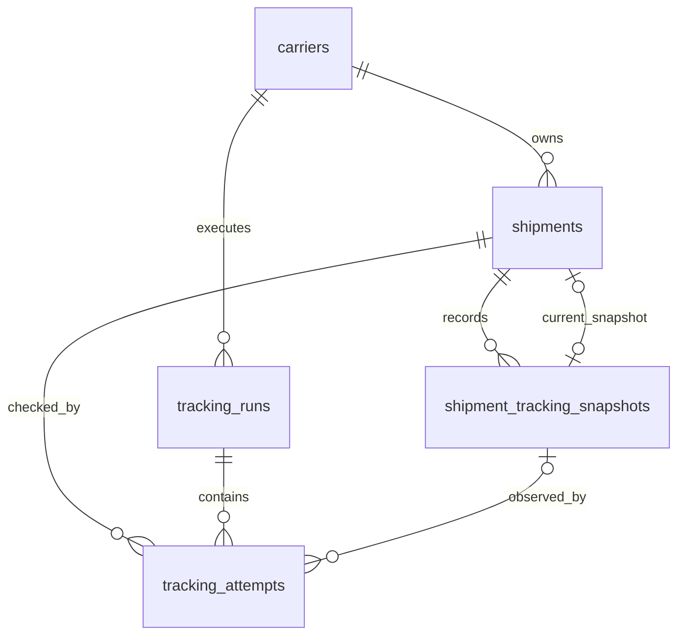

# Backend PostgreSQL schema

## Status

Finalized initial schema for the fresh NestJS backend. Implement it with reviewed TypeORM migrations; do not use TypeORM schema synchronization outside disposable local experiments.

The initial schema has five tables:

1. `carriers`
2. `shipments`
3. `shipment_tracking_snapshots`
4. `tracking_runs`
5. `tracking_attempts`

Raw-artifact storage, source-data retention, authentication relations, notifications/outbox, and a durable queue remain outside this initial schema.

## Relationship diagram



## Foreign-key deletion policy

Every initial foreign key explicitly uses `ON DELETE NO ACTION`, with immediate,
non-deferrable checks. This user-approved V1-005 decision supersedes the earlier
cascade/restrict policies. Future foreign keys follow the default in `AGENTS.md`;
another deletion action requires an explicit user override.

Soft deletion preserves relationships. A permanent Shipment purge must explicitly
clear its current-snapshot pointer, delete its attempts, delete its snapshots,
and finally delete the Shipment in one transaction. A tracking run can be deleted
only after its attempts are removed; a Carrier only after its Shipments and runs
are removed. This ticket verifies those database rules but adds no purge API.

## Shared entity columns

Mutable API-exposed business entities—initially Carrier and Shipment—extend `ExternallyIdentifiedEntity`, which extends `AuditableEntity`.

| Column          | Type                                   | Null | Rule                                                            |
| --------------- | -------------------------------------- | ---- | --------------------------------------------------------------- |
| `id`            | `integer generated always as identity` | No   | Internal primary key; never expose through the API.             |
| `external_id`   | `uuid`                                 | No   | Immutable, unique, database-generated with `gen_random_uuid()`. |
| `created_at`    | `timestamptz`                          | No   | Defaults to `now()`.                                            |
| `updated_at`    | `timestamptz`                          | No   | Defaults to `now()` and is maintained by TypeORM writes.        |
| `deleted_at`    | `timestamptz`                          | Yes  | Soft-deletion timestamp.                                        |
| `created_by_id` | `integer`                              | Yes  | Future User relation; no foreign key initially.                 |
| `updated_by_id` | `integer`                              | Yes  | Future User relation; no foreign key initially.                 |
| `deleted_by_id` | `integer`                              | Yes  | Future User relation; no foreign key initially.                 |

Append-only history and operational tables use purpose-specific timestamps instead of inheriting misleading soft-delete and actor-update fields.

Both primary `id` and public `external_id` values are immutable after insertion.
Reviewed migrations must reject changes at the PostgreSQL boundary, including
direct SQL and resetting an identity with `SET id = DEFAULT`. TypeORM mapping
restrictions alone are insufficient. V1-004 proves this with a disposable fixture;
V1-005 applies it to the production tables.

## Database enums

| Enum                         | Values                                                                         |
| ---------------------------- | ------------------------------------------------------------------------------ |
| `shipment_monitoring_status` | `active`, `paused`, `completed`                                                |
| `shipment_monitoring_reason` | `manual`, `not_found_threshold`, `delivered`                                   |
| `tracking_run_trigger`       | `scheduled`, `manual`                                                          |
| `tracking_run_status`        | `queued`, `running`, `succeeded`, `partially_succeeded`, `failed`, `cancelled` |
| `tracking_attempt_outcome`   | `pending`, `found`, `not_found`, `failed`, `skipped`                           |

## 1. `carriers`

One row identifies a Carrier and selects its adapter.

| Column                      | Type           | Null | Default/meaning                                                                  |
| --------------------------- | -------------- | ---- | -------------------------------------------------------------------------------- |
| shared entity columns       | —              | —    | Full externally identified audit base.                                           |
| `code`                      | `varchar(50)`  | No   | Stable adapter key.                                                              |
| `name`                      | `varchar(100)` | No   | Carrier display name.                                                            |
| `is_active`                 | `boolean`      | No   | `true`; controls whether new tracking work may use the Carrier.                  |
| `not_found_pause_threshold` | `smallint`     | No   | `5`; consecutive `not_found` results required to pause.                          |
| `poll_interval_minutes`     | `smallint`     | No   | Desired minutes between scheduled checks for a Shipment.                         |
| `rate_limit_per_minute`     | `smallint`     | Yes  | Maximum physical Carrier requests per minute; null disables the generic limiter. |

Rules:

- By the approved V1-007 scope, only reviewed migrations accompanying an implemented
  adapter may create Carriers. Use explicit, nonempty stable adapter codes up to
  50 characters. Automatic slug generation and application creation are deferred.
- Keep `code` immutable when `name` changes.
- Enforce unique `external_id` and unique `code`, including across soft-deleted rows.
- Enforce `not_found_pause_threshold >= 2`; the initial value for every Carrier is `5`.
- Enforce `poll_interval_minutes >= 1`; seed UPS with `30`, EchoShip with `5`, and FFE with `5`.
- Enforce `rate_limit_per_minute IS NULL OR rate_limit_per_minute >= 1`; seed UPS with `10` and leave EchoShip and FFE null initially.
- The effective request limit is the stricter of the database value and the adapter/provider hard maximum. UPS CIE remains capped at 5 requests per minute even when the database value is 10.
- Every physical Carrier request, including a retry inside one logical Attempt, consumes the applicable rate limit.
- The initial single-node worker may enforce this limit in process. If tracking workers later run on multiple nodes, they must share or partition the Carrier quota so each node does not independently spend the full limit.
- Carrier credentials and endpoints remain configuration/secrets, not database columns.
- Referenced Carriers use `ON DELETE NO ACTION`; normal removal is soft deletion or `is_active = false`.
- V1-007 exposes reads and configuration updates only. Administrators use
  `is_active` to disable/enable; no Carrier deletion or restoration API is exposed.
  Existing soft-deleted Carriers are excluded from reads, updates, and active selection.

### Deferred Carrier configuration candidates

These are useful future columns, but they are not part of the initial migration. Add each only when its behavior is implemented and tested.

| Column                  | Proposed type           | Purpose                                                                 |
| ----------------------- | ----------------------- | ----------------------------------------------------------------------- |
| `max_concurrency`       | `smallint` nullable     | Limit simultaneous lookups for one Carrier.                             |
| `failure_retry_minutes` | `smallint` nullable     | Override the delay before retrying a technical Carrier failure.         |
| `display_order`         | `smallint` nullable     | Control Carrier ordering in administrative and selection interfaces.    |
| `maintenance_message`   | `varchar(500)` nullable | Explain why a Carrier is unavailable when an administrator disables it. |

Keep protocol-specific request and browser-navigation timeouts in adapter configuration because those operations have different semantics. Do not add an unstructured Carrier `config jsonb` column as a substitute for reviewed, constrained columns.

## 2. `shipments`

One row represents a Carrier-owned reference that the application monitors.

| Column                         | Type                         | Null | Default/meaning                                                                        |
| ------------------------------ | ---------------------------- | ---- | -------------------------------------------------------------------------------------- |
| shared entity columns          | —                            | —    | Full externally identified audit base.                                                 |
| `carrier_id`                   | `integer`                    | No   | FK to `carriers.id`; `ON DELETE NO ACTION`.                                            |
| `tracking_reference`           | `varchar(255)`               | No   | Tracking number, Shipment ID, or order number understood by the Carrier.               |
| `notes`                        | `varchar(500)`               | Yes  | User-maintained note.                                                                  |
| `verification_url`             | `text`                       | Yes  | Carrier tracking URL.                                                                  |
| `monitoring_status`            | `shipment_monitoring_status` | No   | `active`.                                                                              |
| `monitoring_reason`            | `shipment_monitoring_reason` | Yes  | Why monitoring is paused or completed.                                                 |
| `current_tracking_snapshot_id` | `bigint`                     | Yes  | Current normalized snapshot.                                                           |
| `last_attempted_at`            | `timestamptz`                | Yes  | Completion time of the latest finalized logical Carrier lookup, regardless of outcome. |
| `next_check_at`                | `timestamptz`                | Yes  | Next time the scheduler may select the Shipment.                                       |
| `consecutive_not_found_count`  | `integer`                    | No   | `0`; increments for `not_found`, resets on `found`, and is unchanged by failures.      |
| `lock_version`                 | `integer`                    | No   | `1`; TypeORM optimistic-lock version.                                                  |

Constraints and indexes:

- Partial unique index on `(carrier_id, tracking_reference) WHERE deleted_at IS NULL`.
- Index on `carrier_id`.
- Partial scheduler index on `(next_check_at, id) WHERE deleted_at IS NULL AND monitoring_status = 'active'`.
- Check `consecutive_not_found_count >= 0` and `lock_version >= 1`.
- Monitoring state/reason combinations are restricted to:
  - `active` with no reason;
  - `paused` with `manual` or `not_found_threshold`;
  - `completed` with `delivered`.

A single `not_found` attempt does not change `monitoring_status`, clear the current snapshot, or remove the Shipment from future scheduling. Each consecutive `not_found` increments the counter. When it reaches the Carrier's `not_found_pause_threshold`—initially `5`—set `monitoring_status = 'paused'`, `monitoring_reason = 'not_found_threshold'`, and `next_check_at = NULL`. A later successful manual refresh resets the counter, clears the reason, and returns the Shipment to `active` unless the normalized result is delivered.

V1-008 creates active Shipments with `next_check_at` set to the database wall-clock
time and leaves `verification_url` null until the first successful lookup. Manual
pause permits only active → paused/manual and clears the next check; manual resume
permits only paused/manual → active and schedules immediately. Both preserve the
not-found counter and snapshot pointer. Soft deletion clears the next check but
preserves history. Notes and lifecycle writes increment `lock_version`; no public
optimistic-version API is introduced. Future tracking writes must honor the
version/deletion checks so in-flight work cannot overwrite manual lifecycle changes.

The scheduler wakes every 60 seconds but selects only due Shipments. After a finalized scheduled attempt, compute `next_check_at` from the attempt completion time plus the effective interval. The effective interval is the greater of `carriers.poll_interval_minutes` and any hard minimum exposed by the adapter; UPS CIE therefore remains at least 60 minutes even when its database value is 30. A manual refresh does not move an already-active Shipment's scheduled `next_check_at`; reactivating a paused Shipment schedules its next check from the refresh completion time.

V1-012 measures any additional adapter-minimum eligibility check using scheduled
attempt history, not `last_attempted_at`, because that column includes manual
refreshes. Manual refresh must not delay automatic tracking. Skipped and
worker-interrupted attempts do not establish a new scheduled minimum. This uses
the existing attempt/run tables and requires no additional column or migration.

## 3. `shipment_tracking_snapshots`

One immutable row is the complete normalized tracking state first observed when the known tracking facts changed. Polls that return identical normalized data do not create another snapshot.

| Column                  | Type                                  | Null | Default/meaning                                           |
| ----------------------- | ------------------------------------- | ---- | --------------------------------------------------------- |
| `id`                    | `bigint generated always as identity` | No   | Primary key.                                              |
| `shipment_id`           | `integer`                             | No   | FK to `shipments.id`; `ON DELETE NO ACTION`.              |
| `carrier_status`        | `varchar(255)`                        | Yes  | Carrier-provided display status.                          |
| `carrier_status_detail` | `text`                                | Yes  | Additional Carrier status text.                           |
| `picked_up_on`          | `date`                                | Yes  | Normalized pickup calendar date.                          |
| `estimated_delivery_on` | `date`                                | Yes  | Normalized estimated-delivery calendar date.              |
| `delivered_on`          | `date`                                | Yes  | Normalized actual-delivery calendar date.                 |
| `observed_at`           | `timestamptz`                         | No   | `now()`; when this normalized version was first observed. |

Rules:

- Require at least one of the five tracking fields to be non-null.
- Normalize Carrier dates to valid `YYYY-MM-DD` values before persistence; PostgreSQL stores them as `date`.
- Missing Carrier values preserve the previous known value before comparison and insertion.
- Do not store Carrier credentials, full responses, XML, HTML, or screenshots here.
- No external UUID, soft deletion, `updated_at`, or actor fields; snapshots are immutable.
- Index `(shipment_id, observed_at DESC, id DESC)` for history queries.
- Add unique `(shipment_id, id)` to support ownership-safe composite foreign keys from Shipment and Attempt rows.

`shipments (id, current_tracking_snapshot_id)` references `(shipment_id, id)` so a Shipment cannot point at another Shipment's snapshot. Add the circular foreign key after both tables exist. Snapshot creation and the current-pointer update happen in one transaction.

## 4. `tracking_runs`

One row represents one scheduled or manual execution of one Carrier adapter. A scheduled cycle that processes three Carriers creates three runs. One FFE XML batch is one run containing multiple attempts.

| Column            | Type                                  | Null | Default/meaning                                           |
| ----------------- | ------------------------------------- | ---- | --------------------------------------------------------- |
| `id`              | `bigint generated always as identity` | No   | Internal primary key.                                     |
| `external_id`     | `uuid`                                | No   | Immutable unique job ID generated by `gen_random_uuid()`. |
| `carrier_id`      | `integer`                             | No   | FK to `carriers.id`; `ON DELETE NO ACTION`.               |
| `trigger`         | `tracking_run_trigger`                | No   | `scheduled` or `manual`.                                  |
| `status`          | `tracking_run_status`                 | No   | `queued`.                                                 |
| `reason_code`     | `varchar(100)`                        | Yes  | Machine-readable run failure/cancellation reason.         |
| `message`         | `text`                                | Yes  | Sanitized run-level diagnostic.                           |
| `requested_by_id` | `integer`                             | Yes  | Future User relation for a manual run; no FK initially.   |
| `created_at`      | `timestamptz`                         | No   | `now()`.                                                  |
| `updated_at`      | `timestamptz`                         | No   | `now()` and maintained by TypeORM writes.                 |
| `started_at`      | `timestamptz`                         | Yes  | Set when adapter execution begins.                        |
| `completed_at`    | `timestamptz`                         | Yes  | Set for every terminal status.                            |

Constraints and indexes:

- Unique `external_id`.
- Index `(carrier_id, created_at DESC)`.
- Index `(status, created_at)` for recovery/monitoring.
- `queued`: `started_at` and `completed_at` are null.
- `running`: `started_at` is set and `completed_at` is null.
- `succeeded`, `partially_succeeded`, and `failed` set both `started_at` and `completed_at`.
- `cancelled` requires `completed_at`; `started_at` remains null when cancellation happened while queued.
- Run-level diagnostics describe failures before or around adapter/session execution; per-Shipment diagnostics belong to attempts.

## 5. `tracking_attempts`

One row represents one logical lookup of one Shipment inside a tracking run. HTTP retries and browser retries remain internal to the same attempt.

| Column             | Type                                  | Null | Default/meaning                                                      |
| ------------------ | ------------------------------------- | ---- | -------------------------------------------------------------------- |
| `id`               | `bigint generated always as identity` | No   | Internal primary key.                                                |
| `tracking_run_id`  | `bigint`                              | No   | FK to `tracking_runs.id`; `ON DELETE NO ACTION`.                     |
| `shipment_id`      | `integer`                             | No   | FK to `shipments.id`; `ON DELETE NO ACTION`.                         |
| `outcome`          | `tracking_attempt_outcome`            | No   | `pending`.                                                           |
| `snapshot_id`      | `bigint`                              | Yes  | Normalized snapshot observed by a `found` attempt.                   |
| `snapshot_changed` | `boolean`                             | No   | `false`; true only when this attempt inserted a new snapshot.        |
| `source_data`      | `jsonb`                               | Yes  | Sanitized Carrier fields consumed by the adapter.                    |
| `retryable`        | `boolean`                             | Yes  | Required only for `failed`; means a later lookup may succeed.        |
| `reason_code`      | `varchar(100)`                        | Yes  | Machine-readable failure or skip reason.                             |
| `message`          | `text`                                | Yes  | Sanitized diagnostic; never credentials or full sensitive responses. |
| `started_at`       | `timestamptz`                         | No   | `now()`.                                                             |
| `completed_at`     | `timestamptz`                         | Yes  | Set when the attempt reaches a final outcome.                        |

Constraints and indexes:

- Unique `(tracking_run_id, shipment_id)`; one logical attempt per Shipment per run.
- Index `(shipment_id, started_at DESC)` for Shipment lookup history.
- Index `(tracking_run_id, outcome)` for run summaries.
- If present, `source_data` must be a JSON object.
- `pending` has no `completed_at`; every final outcome has `completed_at`.
- `found` requires `snapshot_id`; other outcomes require `snapshot_id IS NULL`.
- `snapshot_changed = true` is valid only for `found`.
- `failed` requires non-null `retryable` and `reason_code`; non-failed outcomes require `retryable IS NULL`.
- `skipped` requires `reason_code`.
- `(shipment_id, snapshot_id)` references `shipment_tracking_snapshots (shipment_id, id)` so an Attempt cannot point at another Shipment's snapshot.

Meaning of final outcomes:

| Outcome     | Meaning                                                      | Snapshot behavior                                                                  |
| ----------- | ------------------------------------------------------------ | ---------------------------------------------------------------------------------- |
| `found`     | Carrier returned valid normalized tracking data.             | References the new snapshot when changed, otherwise the existing current snapshot. |
| `not_found` | Carrier responded successfully but had no matching Shipment. | No snapshot; Shipment remains active and its known state is preserved.             |
| `failed`    | The lookup could not complete or validate.                   | No snapshot; known state is preserved.                                             |
| `skipped`   | The system intentionally did not perform/persist the lookup. | No snapshot.                                                                       |

## Example data

### Carrier and Shipment

```text
carriers
id  external_id                           code  name  is_active  poll_interval_minutes  rate_limit_per_minute
1   7b32ecb2-40d2-4a11-a469-bdb2477c67da  ups   UPS   true       30                     10

shipments
id  external_id                           carrier_id  tracking_reference  monitoring_status  current_tracking_snapshot_id
42  431fe34f-a69c-4c70-8254-b960df50a229  1           1Z999AA10123456784  active             9001
```

### Snapshot

```text
shipment_tracking_snapshots
id    shipment_id  carrier_status  carrier_status_detail  picked_up_on  estimated_delivery_on  delivered_on  observed_at
9001  42           Moving          In Transit             null          2026-09-22             null          2026-09-20T02:15:00Z
```

### Run and attempts

```text
tracking_runs
id    external_id                           carrier_id  trigger    status
5001  0326d19e-55aa-472f-8b94-f4d389d40f52  1           scheduled  partially_succeeded

tracking_attempts
id    run_id  shipment_id  outcome    snapshot_id  changed  retryable  reason_code
1001  5001    42           found      9001         true     null       null
1002  5001    43           found      9010         false    null       null
1003  5001    44           not_found  null         false    null       null
1004  5001    45           failed     null         false    true       UPS_TIMEOUT
```

Example `source_data` for attempt `1001`:

```json
{
  "trackingNumber": "1Z999AA10123456784",
  "currentStatus": {
    "description": "In Transit",
    "simplifiedTextDescription": "Moving"
  },
  "deliveryDate": [
    {
      "type": "RDD",
      "date": "20260922"
    }
  ]
}
```

## Transaction rules

For a `found` result:

1. Lock/read the Shipment and its current snapshot using the repository transaction.
2. Merge missing Carrier fields with previously known values.
3. If normalized values changed, insert an immutable snapshot and update `current_tracking_snapshot_id`.
4. Complete the Attempt with the observed snapshot and `snapshot_changed` value.
5. Update Shipment scheduling/not-found metadata and commit once.

For `not_found`, `failed`, or `skipped`, do not create or clear a snapshot. Complete the Attempt and update only the Shipment metadata permitted by that outcome.

## Migration order

1. Enable/verify UUID generation support and create enum types.
2. Create `carriers`.
3. Create `shipments` without its current-snapshot foreign key.
4. Create `shipment_tracking_snapshots`.
5. Add the ownership-safe current-snapshot composite foreign key.
6. Create `tracking_runs`.
7. Create `tracking_attempts` and all indexes/check constraints.

## Deferred decisions

- `source_data` access and retention rules. V1-011 permits optional sanitized,
  allowlisted objects for `found`, `not_found`, and `failed`; `skipped` stores null.
- `source_schema_version` and `adapter_version` columns.
- Exact raw-response artifact storage.
- Authentication and User foreign keys.
- Durable notification outbox and queue infrastructure.

See `docs/v1/tracking-source-data-policy.md` for the partially approved source-data design.
