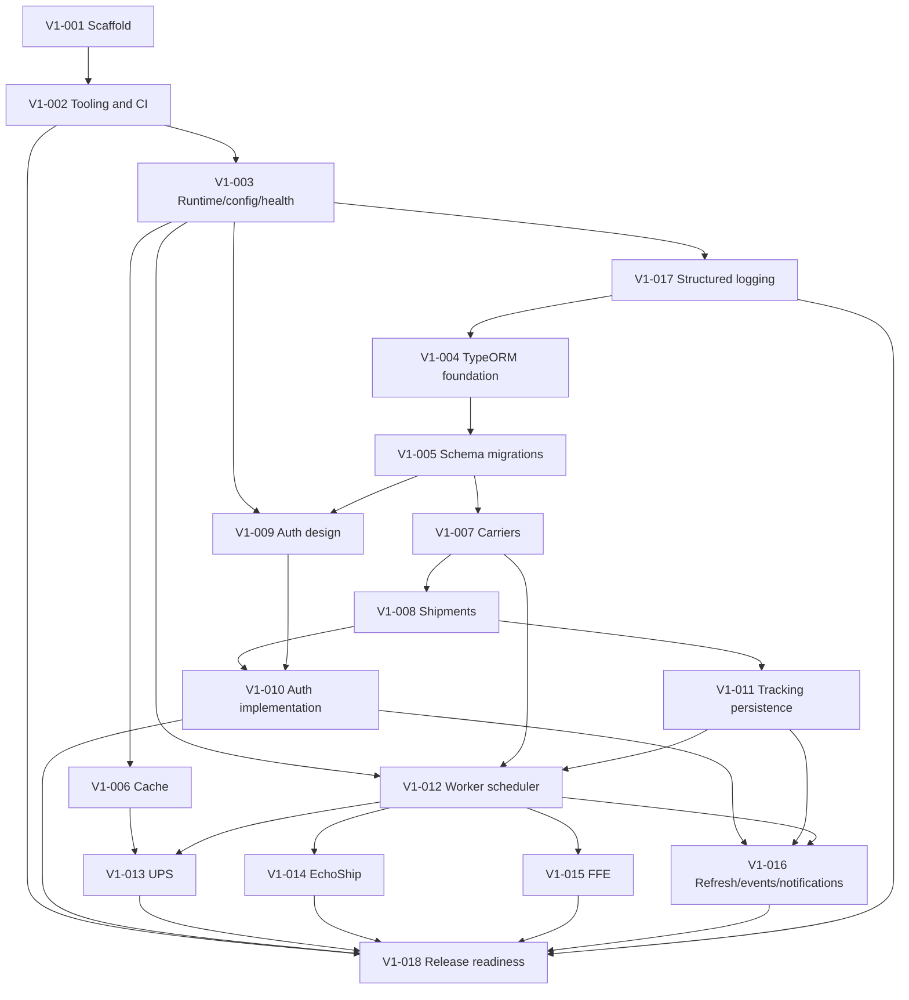

# V1 implementation tickets

Execute one ticket per branch/agent. Read the ticket and every linked document before editing. A ticket is ready only when all dependencies are merged or otherwise present in the working tree.

## Dependency graph

V1-006 and V1-017 can proceed in parallel after runtime composition is established. V1-004 begins after structured logging so database lifecycle code uses the approved logger from its first implementation. V1-009 can begin after configuration and schema foundations. Carrier adapter tickets V1-013 through V1-015 may proceed independently after the worker interface lands, but their final registry wiring must be integrated deliberately.

## Ticket index

| Ticket                                                | Outcome                                                                                   |
| ----------------------------------------------------- | ----------------------------------------------------------------------------------------- |
| [V1-001](V1-001-scaffold-nest-project.md)             | Stable Nest/pnpm project scaffold without losing planning docs.                           |
| [V1-002](V1-002-quality-tooling-and-ci.md)            | Formatting, linting, tests, hooks, and CI gates.                                          |
| [V1-003](V1-003-runtime-config-and-health.md)         | Independent API/worker composition roots, validated configuration, and health.            |
| [V1-004](V1-004-typeorm-and-repository-foundation.md) | PostgreSQL connection, migrations harness, base entities, and repository seam.            |
| [V1-005](V1-005-initial-database-schema.md)           | Five-table schema, constraints, indexes, and Carrier seeds.                               |
| [V1-006](V1-006-in-memory-cache.md)                   | Global per-process in-memory cache and abstract feature cache service.                    |
| [V1-007](V1-007-carriers-module.md)                   | Carrier read/update API, repository, and immutable migration-managed adapter codes.       |
| [V1-008](V1-008-shipments-module.md)                  | Shipment CRUD, soft deletion, atomic bulk creation, and tests.                            |
| [V1-009](V1-009-authentication-design.md)             | Approved auth ADR, schema extension, and dependency choice.                               |
| [V1-010](V1-010-authentication-implementation.md)     | Authenticated principals, guards, authorization, and audit actors.                        |
| [V1-011](V1-011-tracking-persistence.md)              | Runs, attempts, snapshots, outcome transactions, and repositories.                        |
| [V1-012](V1-012-worker-scheduler.md)                  | Auto-starting single worker, due selection, adapter interface, and polling.               |
| [V1-013](V1-013-ups-adapter.md)                       | UPS OAuth/API adapter, token cache, retries, and rate limiting.                           |
| [V1-014](V1-014-echoship-adapter.md)                  | EchoShip request/browser adapters, DB mode selection, isolated sessions and safe mapping. |
| [V1-015](V1-015-ffe-adapter.md)                       | FFE request/browser JSON adapters, one-year searches, isolated sessions and safe mapping. |
| [V1-016](V1-016-refresh-events-and-notifications.md)  | Manual refresh run API, SSE recovery model, and ntfy publishing.                          |
| [V1-017](V1-017-structured-logging.md)                | Shared Pino logging, safe errors, redaction, and request/worker context.                  |
| [V1-018](V1-018-release-readiness.md)                 | Full integration verification, security review, documentation, and v1 gate.               |

## Shared completion rule

V1-015's [request-based exploration](V1-015-ffe-request-exploration.md) confirmed
HTTP login and sequential per-reference JSON retrieval without XML. Native batch
support is unverified; the approved adapter specification uses sequential reads
in one session. See the [implementation summary](../implementation-summary/V1-015-implementation-summary.md)
for verification, boundaries, and deployment notes.

Every implementation ticket must finish with passing relevant format, lint, typecheck, unit, integration/e2e, and build checks. If a listed check cannot run, the handoff must state the exact blocker; it is not silently skipped. Every database behavior is verified against real PostgreSQL, not SQLite or an in-memory substitute.
