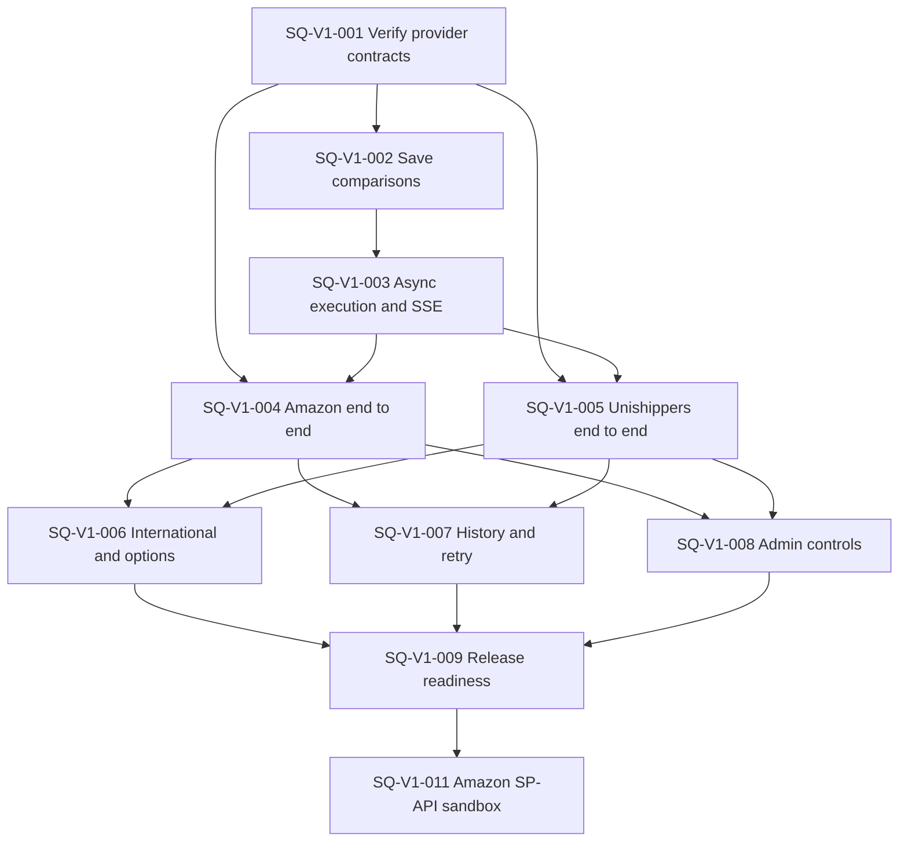

# Unified shipment quote calculator tickets

These tickets implement the approved [shipment quote specification](../../shipping-quotes.md)
across the backend and the sibling `grd-dashboard-fe` repository. Each ticket is a
fresh-context, independently reviewable vertical slice. Read both repositories'
`AGENTS.md` files before changing them.

## Dependency graph

SQ-V1-004 and SQ-V1-005 may proceed in parallel after their shared foundations land.
SQ-V1-006 through SQ-V1-008 may then proceed in parallel.

## Ticket index

SQ-V1-001 has a deterministic harness and live domestic success in both modes
for both providers. Reliability and capability limits remain documented. Its smoke
runner is opt-in and quote-only; see the [contract matrix](SQ-V1-001-contract-matrix.md)
and [implementation summary](../../implementation-summary/SQ-V1-001-implementation-summary.md).

| Ticket                                          | Demonstrable outcome                                                                   |
| ----------------------------------------------- | -------------------------------------------------------------------------------------- |
| [SQ-V1-001](SQ-V1-001-provider-contracts.md)    | Reproducible, sanitized provider contracts and capability matrix.                      |
| [SQ-V1-002](SQ-V1-002-save-comparisons.md)      | Staff can save and reopen immutable quote comparisons.                                 |
| [SQ-V1-003](SQ-V1-003-async-sse.md)             | Durable attempts execute asynchronously and stream progress.                           |
| [SQ-V1-004](SQ-V1-004-amazon.md)                | Amazon rates work through the selected admin mode.                                     |
| [SQ-V1-005](SQ-V1-005-unishippers.md)           | myUnishippers native multi-package rates work end to end.                              |
| [SQ-V1-006](SQ-V1-006-international-options.md) | International inputs, units, signature, insurance, and native currencies are explicit. |
| [SQ-V1-007](SQ-V1-007-history-retry.md)         | History, partial results, ranking, retry, expiry, delete, and restore work.            |
| [SQ-V1-008](SQ-V1-008-admin-controls.md)        | Admins control modes, availability, defaults, connection tests, and stale policy.      |
| [SQ-V1-009](SQ-V1-009-readiness.md)             | Full-stack behavior and operational recovery pass the release gate.                    |
| [SQ-V1-011](SQ-V1-011-amazon-sp-api-sandbox.md) | Amazon quotes use SP-API sandbox with no Amazon browser/CAPTCHA runtime.               |

| [SQ-V1-012](SQ-V1-012-provider-weight-limits.md) | Admin-configurable per-box limits with whole-shipment eligibility and preserved history. |

## Shared completion rule

Each ticket must meet every acceptance criterion and run its listed verification in
both repositories it changes. Live provider checks are quote-only and opt-in: never
accept rates, purchase a label, book a shipment, schedule a pickup, or save provider
account/address changes. Captures must remain sanitized and exclude credentials,
cookies, tokens, account identifiers, and personal contact data.
